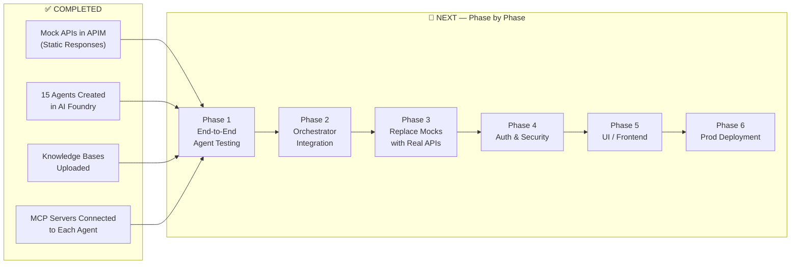

# 🚀 Next Steps — What to Do After Mock APIs + Agents + MCP Are Connected

> **Current State**: ✅ APIs mocked in APIM (static responses) → ✅ Agents created in Azure AI Foundry (system prompts + knowledge bases) → ✅ Separate MCP servers connected to each agent with custom endpoint actions
>
> **This document**: Everything you need to do from here to reach a working, testable, production-ready system.

---

## Status Overview



---

## Phase 1: Individual Agent Testing with Mock MCP (Priority: 🔴 HIGH)

> **Goal**: Verify each agent works correctly with its connected MCP tools and returns proper responses from the static mock data.

### 1.1 Test Each Agent Individually in AI Foundry Playground

For each of the 15 agents, open the **AI Foundry Playground** and run test conversations:

| # | Agent | Test Prompt | Expected Behavior |
|---|-------|-------------|-------------------|
| 1 | **Supervisor-Orchestrator** | "I want to cancel my booking ABC123, last name Smith" | Should classify intent as CANCEL_REFUND, extract PNR=ABC123, lastName=Smith, route to RefundAgent |
| 2 | **Booking-Retrieval-Agent** | "Retrieve booking PNR 9DVWPJ for passenger last name Johnson" | Should call `retrieveOrder` MCP tool → get static mock response → format it properly |
| 3 | **Create-Booking-Agent** | "Search flights from HEL to LHR on 2026-08-20 for 2 adults, economy" | Should call `searchFlights` MCP tool → get mock response → present options |
| 4 | **Name-Change-Agent** | "Change name from John Smith to Jonathan Smith on booking XYZ789" | Should call `retrieveOrder` first → validate policy rules → attempt `addPassengers` |
| 5 | **RefundAgent** | "Check refund eligibility for order 9DVWPJ, last name Smith" | Should call `checkRefundEligibility` MCP tool → parse mock refund data → present breakdown |
| 6 | **Refund-Workflow-Agent** | "Execute refund with proposal ID REF-001 for order 9DVWPJ" | Should call `executeCancellationRefund` MCP tool → confirm refund |
| 7 | **Change-Booking-Agent** | "Change my flight on booking ABC123 to August 25th" | Should call `retrieveOrder` → `searchFlights` → present options |
| 8 | **Rebooking-Agent** | "Rebook passenger on booking ABC123 to next available HEL-LHR flight" | Should call `retrieveOrder` → `searchFlights` → `createCart` |
| 9 | **Disruption-Rebooking-Agent** | "Flight AY123 cancelled. Rebook all passengers on booking ABC123" | Should handle IROP scenario, search alternatives, apply waiver |
| 10 | **Ancillary-Sales-Agent** | "Add 23kg extra baggage to booking 9DVWPJ for all passengers" | Should call `getServiceCatalogue` → `addSeatServices` |
| 11 | **Passenger-SSR-Agent** | "Add wheelchair assistance (WCHR) for passenger on booking ABC123" | Should call `retrieveOrder` → `addSeatServices` with SSR code |
| 12 | **Medical-Exception-Agent** | "Passenger needs fit-to-fly clearance for booking ABC123" | Should check policy, request documents |
| 13 | **Payment-Agent** | "Process payment for booking ABC123, total EUR 450" | Should call `retrieveOrder` → process payment flow |
| 14 | **Case-Management-Agent** | "Open a complaint case for delayed baggage on booking ABC123" | Should create case with SLA |
| 15 | **Communication-Summary-Agent** | "Send booking confirmation email for PNR 9DVWPJ" | Should call `retrieveOrder` → generate email from template |

### 1.2 What to Verify for Each Agent

For each test, check:

- [ ] **MCP tool is called** — Agent actually invokes the MCP tool (not hallucinating a response)
- [ ] **Static mock response is received** — The APIM mock returns the expected static JSON
- [ ] **Agent interprets response correctly** — Agent parses the mock data and generates a meaningful answer
- [ ] **Knowledge base is used** — Agent references policies/rules from its KB (not making up rules)
- [ ] **Error handling works** — Test with invalid PNR, missing fields, edge cases
- [ ] **Response format is professional** — Customer-facing language, proper formatting

### 1.3 Document Issues

Create a test results tracker:

```
| Agent | Test Case | MCP Tool Called? | Response Correct? | Issues Found |
|-------|-----------|-----------------|-------------------|--------------|
| ...   | ...       | ✅/❌           | ✅/❌            | ...          |
```

---

## Phase 2: Orchestrator Integration Testing (Priority: 🔴 HIGH)

> **Goal**: Test the Supervisor-Orchestrator routing to specialized agents end-to-end.

### 2.1 Update the Orchestrator Python Code

The current [orchestrator.py](file:///c:/Users/Agentassist/Downloads/airline%20agent/orchestrator.py) has a `TODO` at line 132 for handling MCP tool calls from specialized agents. This needs to be completed:

```python
# Current TODO (line 130-132):
elif target_run.status == "requires_action":
    # TODO: Implement API tool calling logic here for Amadeus APIs
    return f"Agent {agent_name} requested API actions which need to be executed."
```

**What needs to happen**: When a specialized agent returns `requires_action`, the orchestrator needs to:
1. Extract the MCP tool call from the agent's response
2. Forward the tool call to the MCP server endpoint
3. Return the MCP response back to the agent
4. Let the agent formulate the final answer

### 2.2 Test Multi-Agent Flows

| # | Test Scenario | Expected Agent Chain |
|---|---------------|---------------------|
| 1 | "Show me my booking ABC123" | Supervisor → Booking-Retrieval → MCP:retrieveOrder → Response |
| 2 | "Cancel booking 9DVWPJ and refund, last name Smith" | Supervisor → RefundAgent → MCP:checkRefundEligibility → Refund-Workflow → MCP:executeCancellationRefund |
| 3 | "Change name from John to Jonathan on ABC123" | Supervisor → Booking-Retrieval → Name-Change → MCP:addPassengers |
| 4 | "Book HEL-LHR Aug 20, 2 adults, with extra bag and seat 12A" | Supervisor → Create-Booking → Ancillary-Sales |
| 5 | "Flight cancelled, rebook me on next available" | Supervisor → Disruption-Rebooking → MCP:searchFlights → MCP:createCart |

### 2.3 Test Edge Cases

- [ ] Ambiguous intent — "I need help with my booking" (should ask clarifying question)
- [ ] Multi-intent — "Cancel flight and rebook on tomorrow's flight" (should chain agents)
- [ ] Missing info — "Cancel my booking" without PNR (should ask for PNR)
- [ ] Invalid PNR — "Show booking XXXXXX" (should return proper error)

---

## Phase 3: Replace Mock APIs with Real Backend (Priority: 🟡 MEDIUM)

> **Goal**: Swap the APIM static mock responses with live Amadeus-Nevio backend connections.

### 3.1 Migration Strategy — One API at a Time

> [!IMPORTANT]
> Replace mocks **one API at a time**, not all at once. Test each replacement before moving to the next.

**Recommended order** (from safest to most impactful):

| Order | API | Risk Level | Reason |
|-------|-----|-----------|--------|
| 1 | `/searchpanel` (GET config data) | 🟢 Low | Read-only, no side effects |
| 2 | `/shop/flights` (search flights) | 🟢 Low | Read-only search |
| 3 | `/orders/retrieve` (retrieve order) | 🟢 Low | Read-only order lookup |
| 4 | `/cancelAndRefund` Query (check eligibility) | 🟢 Low | Read-only eligibility check |
| 5 | `/services` (service catalogue) | 🟢 Low | Read-only catalogue |
| 6 | `/seatmap` (seat map) | 🟢 Low | Read-only |
| 7 | `/create-cart` (create cart) | 🟡 Medium | Creates data, but can be abandoned |
| 8 | `/checkout/passengers` (add passengers) | 🟡 Medium | Modifies cart data |
| 9 | `/seat/services` (add/remove services) | 🟡 Medium | Modifies cart |
| 10 | `/checkoutConfirm` (create booking) | 🔴 High | Creates real PNR — **test in sandbox first** |
| 11 | `/cancelAndRefund` Mutation (process refund) | 🔴 High | Processes real refund — **sandbox only** |

### 3.2 For Each API Replacement

1. **Remove the mock policy** from APIM (the `<return-response>` or static mock-response policy)
2. **Set the backend URL** to the real Amadeus-Nevio endpoint
3. **Add the GraphQL body transformation policy** (the `<set-body>` policy from the APIM plan)
4. **Add authentication headers** (JWT token injection)
5. **Test via APIM's "Test" tab** before letting agents use it
6. **Test the agent** that uses this API to confirm it handles real response shapes

### 3.3 Handle Response Shape Differences

> [!WARNING]
> Real API responses will likely differ from your static mocks. You may need to update:
> - Agent system prompts (if they reference specific field names)
> - Knowledge base documents (if response parsing instructions change)
> - MCP tool schemas (if the input/output shapes change)

---

## Phase 4: Authentication & Security Setup (Priority: 🟡 MEDIUM)

> **Goal**: Secure the full pipeline — Agent → MCP → APIM → Backend.

### 4.1 Authentication Chain

```
Agent (Managed Identity) 
  → MCP Server (Azure AD OAuth 2.0)
    → APIM Gateway (Subscription Key + Azure AD validation)
      → Backend (JWT Bearer token)
```

### 4.2 Tasks

| # | Task | Details |
|---|------|---------|
| 1 | **APIM Subscription Keys** | Create subscription keys for MCP server access to APIM |
| 2 | **Azure AD App Registration** | Register the AI Foundry project as an app for OAuth2 token flow |
| 3 | **Managed Identity** | Enable Managed Identity on the AI Foundry project; grant APIM access |
| 4 | **APIM validate-azure-ad-token Policy** | Add `<validate-azure-ad-token>` to APIM global inbound policy |
| 5 | **Backend JWT Token Management** | Implement token rotation — currently the Nevio JWT needs refresh logic |
| 6 | **Named Values in APIM** | Store backend JWT, client IDs, tenant IDs as Named Values (Key Vault-backed) |
| 7 | **Rate Limiting** | Configure `<rate-limit>` policy per agent (prevent runaway agent loops) |
| 8 | **IP Whitelisting** | Restrict APIM access to AI Foundry IP ranges only |

### 4.3 MCP Authentication Configuration

For each agent's MCP connection in AI Foundry:

```
Agent → Tools → MCP Server → Edit
├── Authentication Type: API Key / OAuth 2.0 / Managed Identity
├── Header Name: Ocp-Apim-Subscription-Key (for APIM)
├── Header Value: <subscription-key>
└── Save
```

---

## Phase 5: Build the Frontend / UI (Priority: 🟡 MEDIUM)

> **Goal**: Create the user-facing interface for customer service agents and/or self-service.

### 5.1 Options

| Option | Best For | Technology |
|--------|----------|-----------|
| **A: Azure AI Foundry Playground** | Internal testing, demo | Already available — no build needed |
| **B: Custom Chat UI** | Customer-facing self-service | React/Next.js + Azure AI SDK |
| **C: Teams Integration** | Internal agent desktop | Azure Bot Framework + Teams |
| **D: Existing Service Center UI** | Integrate into current Nevio UI | Embed via SDK/API calls |

### 5.2 Minimum Chat UI Requirements

If building a custom UI:

- [ ] **Chat interface** — Streaming responses, message history
- [ ] **Conversation context** — Thread management (Azure AI threads)
- [ ] **PNR input field** — Quick PNR lookup shortcut
- [ ] **Agent status indicator** — Show which agent is processing
- [ ] **Agent routing visibility** — Show the supervisor's routing decision (for internal users)
- [ ] **Booking summary card** — Rich card showing booking details when retrieved
- [ ] **Refund breakdown display** — Formatted table for refund amounts
- [ ] **Confirmation modals** — Before executing destructive actions (cancel, refund)
- [ ] **Escalation button** — Manual escalation to human agent
- [ ] **Conversation history** — Store and retrieve past conversations

---

## Phase 6: Production Readiness (Priority: 🟢 LATER)

> **Goal**: Harden the system for production traffic.

### 6.1 Observability & Monitoring

| # | Task | Tool |
|---|------|------|
| 1 | **APIM Analytics** | Enable Application Insights in APIM for API call tracking |
| 2 | **Agent Traces** | Enable Azure AI Foundry tracing for agent execution logs |
| 3 | **MCP Request Logging** | Log all MCP tool invocations with request/response payloads |
| 4 | **Dashboard** | Create Azure Dashboard with: API latency, error rates, agent routing distribution |
| 5 | **Alerts** | Set up alerts for: API failures, agent timeouts, high error rates |

### 6.2 Error Handling & Resilience

- [ ] **Retry policies** in APIM for transient backend failures
- [ ] **Circuit breaker** pattern if backend goes down
- [ ] **Timeout configuration** — Set max execution time for each agent (prevent infinite loops)
- [ ] **Fallback responses** — If MCP tool fails, agent should gracefully inform customer
- [ ] **Dead letter queue** — For failed agent requests that need manual review

### 6.3 Content Safety & Guardrails

- [ ] **Azure AI Content Safety** — Enable content filtering on all agents
- [ ] **Prompt injection protection** — Agents should not execute arbitrary instructions from customer input
- [ ] **PII handling** — Ensure passport numbers, credit card numbers are masked in logs
- [ ] **Grounding validation** — Agents must only respond based on KB + API data (no hallucination)

### 6.4 Performance Optimization

- [ ] **APIM Response Caching** — Cache read-only responses (searchpanel, flight search) for 5-15 minutes
- [ ] **Agent model selection** — Use GPT-4o-mini for simple agents (booking retrieval), GPT-4o for complex ones (supervisor, disruption)
- [ ] **Parallel agent execution** — For multi-intent requests, run independent agents in parallel

---

## Phase 7: Advanced Features (Priority: 🟢 FUTURE)

| Feature | Description |
|---------|-------------|
| **Conversation Memory** | Persist conversation context across sessions (returning customers) |
| **Agent Learning** | Capture successful interaction patterns and feed back into knowledge bases |
| **Proactive Notifications** | Agent-initiated outreach for disruptions, payment reminders |
| **Multi-language Support** | Add system prompt translations and language detection |
| **Voice Integration** | Connect to Azure Communication Services for voice channel |
| **A/B Testing** | Test different system prompts and compare agent accuracy |
| **Human-in-the-Loop** | Approval workflow for high-value operations (refunds > €500, name changes) |

---

## Immediate Action Items — What to Do RIGHT NOW

> [!IMPORTANT]
> Start with these 5 tasks today:

### ✅ Task 1: Test Supervisor Routing (30 min)
Open the Supervisor-Orchestrator-Agent in AI Foundry Playground. Send 10 different customer requests. Verify it classifies intent and routes correctly.

### ✅ Task 2: Test 3 Key Agents with MCP (1 hour)
Test these 3 agents that cover the most common flows:
1. **Booking-Retrieval-Agent** — "Show booking 9DVWPJ"
2. **RefundAgent** — "Check refund for order 9DVWPJ"
3. **Create-Booking-Agent** — "Search flights HEL to LHR"

Verify MCP tools are called and mock responses are returned.

### ✅ Task 3: Fix the Orchestrator Code (2 hours)
Update [orchestrator.py](file:///c:/Users/Agentassist/Downloads/airline%20agent/orchestrator.py) to handle `requires_action` from specialized agents — forward MCP tool calls and return results.

### ✅ Task 4: Test One End-to-End Flow (1 hour)
Run the full chain: Customer message → Supervisor → Specialized Agent → MCP Tool → Mock API → Response back to customer.

### ✅ Task 5: Document Test Results (30 min)
Create a test results spreadsheet tracking which agents work, which have issues, and what needs fixing.
