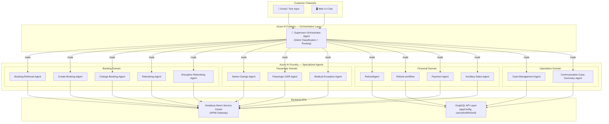
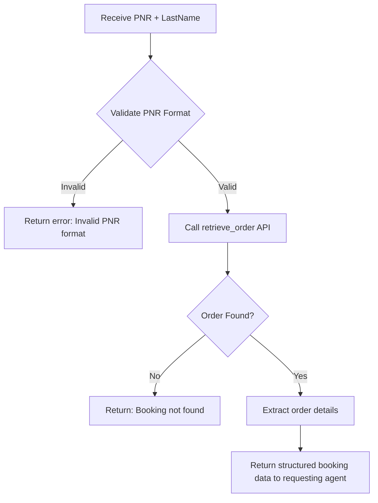
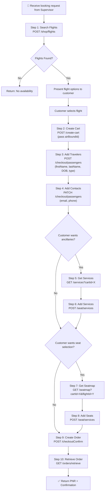
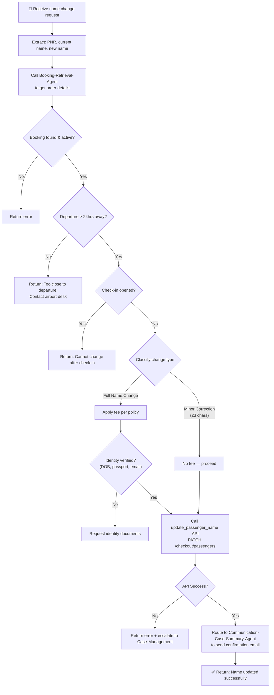
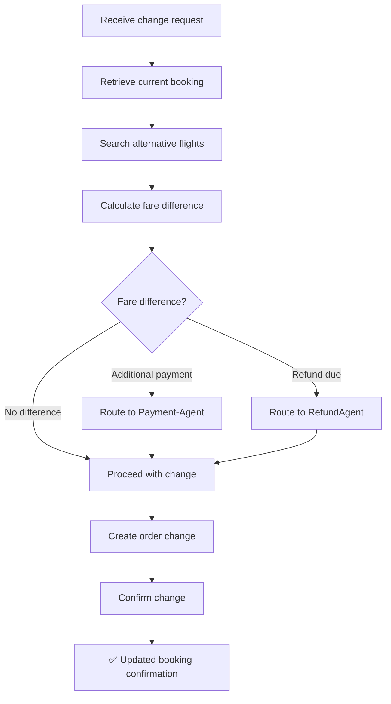
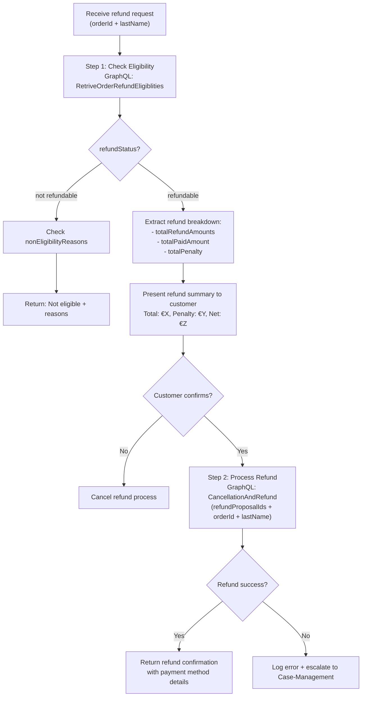
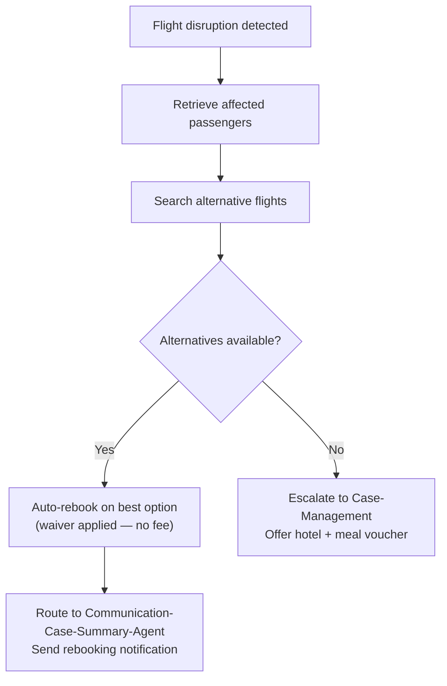
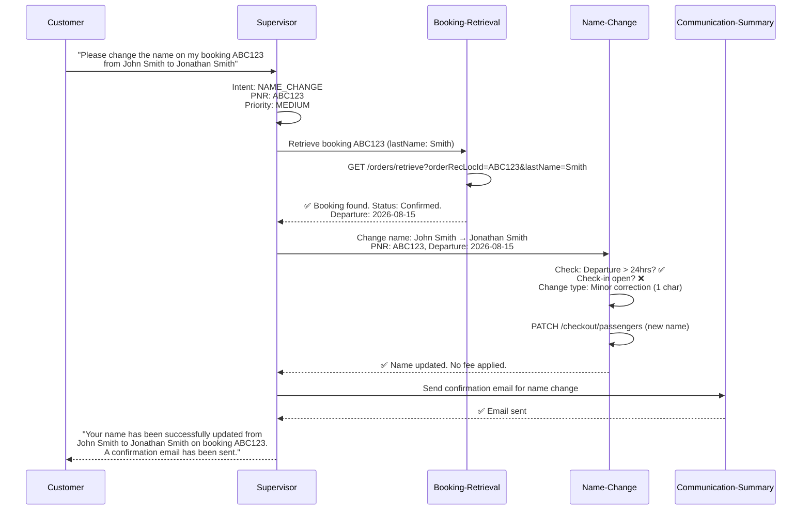
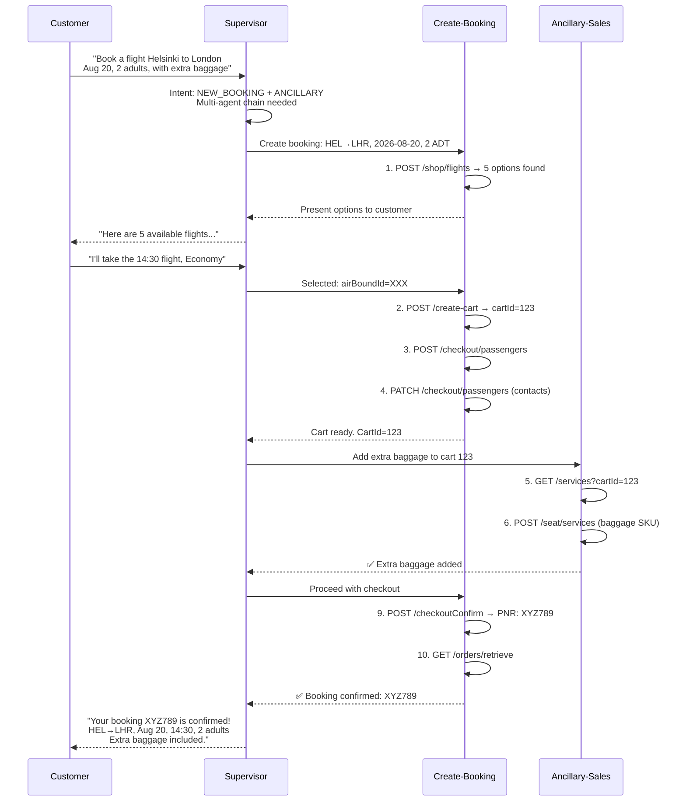
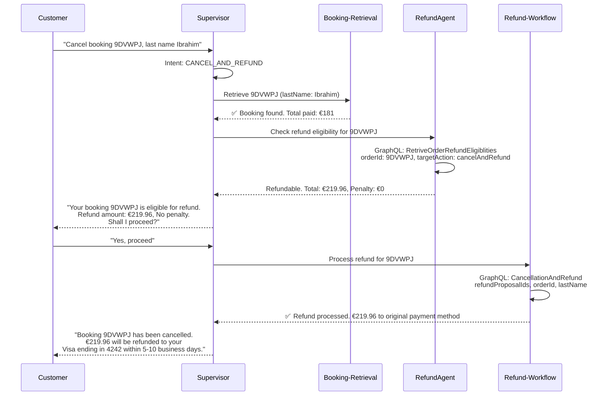

# ✈️ Airline Multi-Agent Orchestrator System — Master Implementation Plan

> **Platform**: Azure AI Foundry | **Airline Partner**: AY (Finnair) | **API Backend**: Amadeus-Nevio Service Center  
> **APIM Gateway**: `https://nevioservicecenterapim.azure-api.net`

---

## 1. System Overview & Architecture

This plan designs a **Supervisor-Orchestrator Agent** pattern on Azure AI Foundry that receives customer requests (email, chat, or UI text), analyzes intent, and routes to the correct specialized agent. Each agent has defined skills, knowledge, and API tool-bindings to the Amadeus-Nevio backend.

### 1.1 Architecture Diagram



---

## 2. Supervisor-Orchestrator-Agent — The Brain

### 2.1 Purpose
The Supervisor is the **single entry-point**. It never executes airline operations itself — it only:
1. **Classifies intent** from raw customer text/email
2. **Extracts key entities** (PNR, passenger name, flight number, dates)
3. **Maps to the correct agent** (or chain of agents)
4. **Monitors execution** and assembles the final response

### 2.2 System Prompt (for Azure AI Foundry Agent Configuration)

```
You are the Supervisor-Orchestrator-Agent for an airline service center. You have 30 years of airline operations experience.

YOUR ROLE:
- Receive customer requests from email, chat, or UI
- Analyze the request to determine customer intent
- Extract critical entities: PNR/Order ID, passenger name, flight details, dates
- Route to the correct specialized agent(s) based on the intent mapping below
- Coordinate multi-agent workflows when a request spans multiple domains
- Return a consolidated response to the customer

INTENT-TO-AGENT MAPPING:
| Intent Category          | Keywords / Signals                                                        | Target Agent                        |
|--------------------------|---------------------------------------------------------------------------|-------------------------------------|
| New Booking              | "book a flight", "new reservation", "search flights"                      | Create-Booking-Agent                |
| Retrieve Booking         | "show my booking", "pull up PNR", "find reservation"                      | Booking-Retrieval-Agent             |
| Change Booking           | "change flight", "modify itinerary", "reschedule"                         | Change-Booking-Agent                |
| Name Change              | "change name", "spelling correction", "passenger name update"             | Name-Change-Agent                   |
| Cancel & Refund          | "cancel booking", "request refund", "money back"                          | RefundAgent → Refund-workflow       |
| Rebooking                | "rebook", "alternative flight", "missed connection"                       | Rebooking-Agent                     |
| Disruption Rebooking     | "flight cancelled", "delay", "irregular operations", "IROP"              | Disruption-Rebooking-Agent          |
| Add Services/Ancillaries | "extra baggage", "meal", "lounge access", "upgrade"                       | Ancillary-Sales-Agent               |
| Seat Selection           | "choose seat", "seat map", "window seat", "seat change"                   | Ancillary-Sales-Agent               |
| Special Service Request  | "wheelchair", "unaccompanied minor", "special meal", "SSR"                | Passenger-SSR-Agent                 |
| Medical Exception        | "medical certificate", "fit to fly", "health clearance"                   | Medical-Exception-Agent             |
| Payment                  | "payment issue", "pay balance", "credit card update"                      | Payment-Agent                       |
| Case Management          | "case status", "open case", "complaint", "follow up"                      | Case-Management-Agent               |
| Communication Summary    | "send confirmation", "email summary", "case notes"                        | Communication-Case-Summary-Agent    |

MULTI-AGENT CHAINING RULES:
1. "Book a flight with extra baggage and seat 12A" → Create-Booking-Agent → Ancillary-Sales-Agent
2. "Cancel and rebook on next available" → RefundAgent → Rebooking-Agent
3. "Change name and add wheelchair" → Name-Change-Agent → Passenger-SSR-Agent
4. Any name change → always Booking-Retrieval-Agent first to validate PNR, then Name-Change-Agent
5. Any refund → always Booking-Retrieval-Agent first to validate order, then RefundAgent

CRITICAL RULES:
- ALWAYS extract and validate the PNR/Order ID before routing
- NEVER execute airline operations directly — only route to agents
- If intent is ambiguous, ask the customer for clarification
- Log every routing decision for audit trail
- For name changes, verify identity before proceeding (DOB, passport number)
```

### 2.3 Supervisor Knowledge Files (Upload to Azure AI Foundry)

| File Name | Contents |
|-----------|----------|
| `airline_policies.md` | Name change rules, refund policies, rebooking windows, penalty structures |
| `intent_examples.json` | 200+ labeled examples of customer requests mapped to intents |
| `api_entity_mapping.json` | Maps extracted entities to API parameter names |
| `escalation_matrix.md` | When to escalate to human agent (fraud, VIP, legal) |

---

## 3. Complete Agent Registry — Skills, Knowledge & Workflows

### 3.1 Booking-Retrieval-Agent

| Property | Value |
|----------|-------|
| **Purpose** | Retrieve existing bookings/orders by PNR, passenger name, or order ID |
| **Version** | 1 |
| **Upstream Agent** | Supervisor-Orchestrator-Agent |
| **Downstream Agents** | Any agent that needs booking context |

**Skills (Azure AI Foundry Functions/Tools):**

| Tool Name | API Endpoint | Method | Description |
|-----------|-------------|--------|-------------|
| `retrieve_order` | `{{gateway_url}}/v2/purchase/orders/{{orderRecLocId}}?lastName={{lastName}}&showOrderEligibilities=true` | GET | Retrieve order by PNR + last name |
| `search_order` | `{{gateway_url}}/v2/purchase/orders/search` | POST | Search orders by various criteria |

**Knowledge Files:**
- `order_status_codes.md` — Mapping of order statuses (confirmed, ticketed, cancelled, suspended)
- `pnr_format_rules.md` — PNR validation rules (6 alphanumeric characters)

**Workflow:**


---

### 3.2 Create-Booking-Agent

| Property | Value |
|----------|-------|
| **Purpose** | Create new flight bookings end-to-end via the Amadeus-Nevio shopping flow |
| **Version** | 2 |
| **Upstream Agent** | Supervisor-Orchestrator-Agent |
| **Downstream Agents** | Ancillary-Sales-Agent (optional), Payment-Agent |

**Skills (Azure AI Foundry Functions/Tools):**

| Step | Tool Name | API Endpoint | Method | Description |
|------|-----------|-------------|--------|-------------|
| 1 | `search_flights` | `{{APIM_URL}}/shop/flights` | POST | Search available flights (origin, destination, date, pax count) |
| 2 | `create_cart` | `{{APIM_URL}}/create-cart` | POST | Create cart with selected airBoundId |
| 3 | `add_travelers` | `{{APIM_URL}}/checkout/passengers` | POST | Add passenger details to cart |
| 4 | `add_contacts` | `{{APIM_URL}}/checkout/passengers` | PATCH | Add contact information |
| 5 | `get_service_catalogue` | `{{APIM_URL}}/services` | GET | List available ancillary services |
| 6 | `add_services` | `{{APIM_URL}}/seat/services` | POST | Add selected services to cart |
| 7 | `get_seatmap` | `{{APIM_URL}}/seatmap` | GET | Get seat map for flight |
| 8 | `add_seats` | `{{APIM_URL}}/seat/services` | POST | Assign seats to passengers |
| 9 | `create_order` | `{{APIM_URL}}/checkoutConfirm` | POST | Create order (prebook) |
| 10 | `retrieve_order` | `{{APIM_URL}}/orders/retrieve` | GET | Retrieve confirmed PNR |

**Knowledge Files:**
- `booking_flow_guide.md` — Step-by-step booking flow with mandatory vs optional steps
- `fare_families.md` — Fare family descriptions, included services, restrictions
- `passenger_type_codes.md` — ADT, CHD, INF, YTH — age rules and discount codes
- `cabin_classes.md` — Economy, Premium Economy, Business, First

**Complete Booking Workflow:**


---

### 3.3 Name-Change-Agent

| Property | Value |
|----------|-------|
| **Purpose** | Process passenger name corrections/changes on existing bookings |
| **Version** | 2 |
| **Upstream Agent** | Supervisor-Orchestrator-Agent → Booking-Retrieval-Agent |
| **Downstream Agents** | Communication-Case-Summary-Agent |

**Skills (Azure AI Foundry Functions/Tools):**

| Tool Name | API Endpoint | Method | Description |
|-----------|-------------|--------|-------------|
| `retrieve_order` | `{{APIM_URL}}/orders/retrieve` | GET | Retrieve current booking details |
| `update_passenger_name` | `{{APIM_URL}}/checkout/passengers` | PATCH | Update passenger name fields |
| `validate_name_change` | Internal logic | — | Validate name change against airline policy |

**Knowledge Files:**
- `name_change_policy.md`:
  ```
  AIRLINE NAME CHANGE POLICY:
  
  1. MINOR CORRECTIONS (No fee):
     - Spelling corrections up to 3 characters
     - Adding/removing middle name
     - Correcting title (Mr/Mrs/Ms)
  
  2. FULL NAME CHANGE (Fee applies):
     - Complete first or last name change
     - Requires supporting documentation
     - Fee: Per airline policy (typically €50-€150)
     - Must be done minimum 24 hours before departure
  
  3. NOT ALLOWED:
     - Name transfer to a different person (requires cancel + rebook)
     - Changes after check-in has opened
     - Changes on non-refundable tickets without waiver
  
  4. REQUIRED DOCUMENTS:
     - Valid passport/ID showing new name
     - Marriage certificate (for married name change)
     - Court order (for legal name change)
  
  5. IDENTITY VERIFICATION:
     - Must verify: Date of birth, original booking email, passport number
  ```

**Name Change Workflow:**


---

### 3.4 Change-Booking-Agent

| Property | Value |
|----------|-------|
| **Purpose** | Modify existing bookings — change dates, routes, or cabin class |
| **Version** | 3 |
| **Upstream Agent** | Supervisor-Orchestrator-Agent |
| **Downstream Agents** | Payment-Agent (for fare difference), Ancillary-Sales-Agent |

**Skills (Tools):**

| Tool Name | Endpoint | Description |
|-----------|----------|-------------|
| `retrieve_order` | `/orders/retrieve` | Get current booking |
| `search_rebooking_options` | `/shop/flights` | Search alternative flights |
| `create_order_change` | `/create-cart` | Create change order |
| `confirm_change` | `/checkoutConfirm` | Confirm the modification |

**Knowledge Files:**
- `change_fee_matrix.md` — Fare rules, change fees by fare family, fare difference calculations
- `same_day_change_rules.md` — Standby vs confirmed same-day changes

**Workflow:**


---

### 3.5 RefundAgent + Refund-workflow

| Property | Value |
|----------|-------|
| **Purpose** | Assess refund eligibility and process cancellation & refunds |
| **Version** | RefundAgent v2, Refund-workflow v1 |
| **Upstream Agent** | Supervisor-Orchestrator-Agent |
| **Downstream Agents** | Payment-Agent, Communication-Case-Summary-Agent |

**Skills (Tools):**

| Tool Name | Endpoint | Method | Description |
|-----------|----------|--------|-------------|
| `check_refund_eligibility` | `{{APIM_URL}}/cancelAndRefund` (GraphQL) | POST | `RetriveOrderRefundEligiblities` query |
| `process_refund` | `{{APIM_URL}}/cancelAndRefund` (GraphQL) | POST | `CancellationAndRefund` mutation |

**Knowledge Files:**
- `refund_policy.md` — Refund rules by fare type, 24-hour rule, EU261 regulations
- `refund_eligibility_structure.json` — GraphQL query/mutation schemas (from your refund structure file)
- `refund_response_format.md` — How to parse refund amounts, penalties, payment details

**Workflow:**


---

### 3.6 Rebooking-Agent

| Property | Value |
|----------|-------|
| **Purpose** | Rebook passengers on alternative flights (voluntary rebooking) |
| **Version** | 1 |
| **Skills** | `search_flights`, `create_cart`, `add_travelers`, `confirm_order` |
| **Knowledge** | Rebooking policies, standby rules, fare difference handling |

---

### 3.7 Disruption-Rebooking-Agent

| Property | Value |
|----------|-------|
| **Purpose** | Handle involuntary rebooking due to IROP (Irregular Operations) — cancellations, delays, diversions |
| **Version** | 2 |
| **Skills** | `search_alternatives`, `auto_rebook`, `apply_waiver`, `send_notification` |
| **Knowledge** | EU261 compensation rules, IROP policies, meal/hotel voucher eligibility, minimum connection times |

**Workflow:**


---

### 3.8 Ancillary-Sales-Agent

| Property | Value |
|----------|-------|
| **Purpose** | Sell and manage ancillary services — baggage, meals, lounge, upgrades, seats |
| **Version** | 2 |

**Skills (Tools):**

| Tool Name | Endpoint | Description |
|-----------|----------|-------------|
| `get_service_catalogue` | `/services` | List available services for a cart/order |
| `add_services` | `/seat/services` (POST) | Add services to cart |
| `delete_services` | `/seat/services` (DELETE) | Remove services from cart |
| `get_seatmap` | `/seatmap` | Get seat map for flight |
| `add_seats` | `/seat/services` (POST) | Assign seat to passenger |
| `delete_seats` | `/seat/services` (DELETE) | Remove seat assignment |
| `post_order_services` | `/services` (POST-ORDER) | Add services after booking confirmed |
| `post_order_seatmap` | `/seatmap` (POST-ORDER) | Get seatmap for post-order changes |
| `post_order_add_seats` | `/seat/services` (POST-ORDER) | Add seats after booking |
| `post_order_add_services` | `/seat/services` (POST-ORDER) | Add services after booking |

**Knowledge Files:**
- `service_catalogue_guide.md` — All available ancillary services and pricing
- `seat_types.md` — Standard, extra legroom, emergency exit, premium seats
- `promotion_codes.md` — Available promo codes (e.g., `SCUISEATP`)

---

### 3.9 Passenger-SSR-Agent

| Property | Value |
|----------|-------|
| **Purpose** | Manage Special Service Requests — wheelchair (WCHR/WCHC), special meals (VGML/DBML), unaccompanied minor (UMNR) |
| **Version** | 2 |
| **Skills** | `add_ssr`, `remove_ssr`, `list_available_ssr` |
| **Knowledge** | SSR codes (IATA standard), age rules for UMNR, dietary restriction codes |

---

### 3.10 Medical-Exception-Agent

| Property | Value |
|----------|-------|
| **Purpose** | Process medical clearance requests, fit-to-fly certificates, and medical equipment approvals |
| **Version** | 1 |
| **Skills** | `submit_medical_request`, `check_medical_status`, `upload_medical_document` |
| **Knowledge** | MEDIF form requirements, fit-to-fly rules, oxygen equipment policies |

---

### 3.11 Payment-Agent

| Property | Value |
|----------|-------|
| **Purpose** | Process payments, handle fare differences, refund payment methods |
| **Version** | 1 |
| **Skills** | `process_payment`, `validate_payment_method`, `retrieve_payment_status` |
| **Knowledge** | Supported payment methods, currency conversion rules, PCI compliance |

---

### 3.12 Case-Management-Agent

| Property | Value |
|----------|-------|
| **Purpose** | Create and manage service cases — complaints, escalations, follow-ups |
| **Version** | 1 |
| **Skills** | `create_case`, `update_case`, `close_case`, `escalate_case` |
| **Knowledge** | Case priority matrix, SLA timelines, escalation paths |

---

### 3.13 Communication-Case-Summary-Agent

| Property | Value |
|----------|-------|
| **Purpose** | Generate and send communication — confirmation emails, case summaries, notifications |
| **Version** | 1 |
| **Skills** | `send_email`, `generate_summary`, `create_case_notes` |
| **Knowledge** | Email templates, communication tone guidelines, GDPR data handling |

---

## 4. Amadeus-Nevio API Flow — Complete Technical Reference

### 4.1 API Endpoints Summary

| Step | Name | Endpoint | Method | Key Input | Key Output |
|------|------|----------|--------|-----------|------------|
| 0a | JWT Auth | `/token` | POST | credentials | `JWT_Token` |
| 0b | Amadeus Auth | `/token/amadeus` | POST | JWT_Token | `Amadeus_Token` |
| 1 | Search Panel | `/searchpanel` | GET | — | Airport/city options |
| 2 | Shop Flights | `/shop/flights` | POST | origin, dest, date, pax | `airBoundId`, flight list |
| 3 | Create Cart | `/create-cart` | POST | airBoundId | `cartId`, passengerId |
| 4 | Add Travelers | `/checkout/passengers` | POST | cartId, passenger details | traveler confirmation |
| 5 | Add Contacts | `/checkout/passengers` | PATCH | cartId, contact info | contact confirmation |
| 6 | Service Catalogue | `/services` | GET | cartId, promoCode | service list with SKUs |
| 7 | Add Services | `/seat/services` | POST | cartId, serviceSelections | services added |
| 8 | Seat Map | `/seatmap` | GET | cartId, flightId, promoCode | seat map layout |
| 9 | Add Seats | `/seat/services` | POST | cartId, seatSelections | seats assigned |
| 10 | Checkout Confirm | `/checkoutConfirm` | POST | cartId | `orderRecLocId` (PNR) |
| 11 | Retrieve Order | `/orders/retrieve` | GET | orderRecLocId, lastName | full order details |

### 4.2 Post-Order Operations

| Operation | Endpoint | Description |
|-----------|----------|-------------|
| Post-Order Services | `/services` (POST) | Add services to confirmed booking |
| Post-Order Seatmap | `/seatmap` (GET) | Get seatmap for confirmed booking |
| Post-Order Add Seats | `/seat/services` (POST) | Add seats to confirmed booking |
| Post-Order Add Services | `/seat/services` (POST) | Add services to confirmed booking |

### 4.3 Cancel & Refund (GraphQL)

| Operation | Endpoint | Type | Description |
|-----------|----------|------|-------------|
| Check Eligibility | `/cancelAndRefund` | Query: `RetriveOrderRefundEligiblities` | Check if order is refundable |
| Process Refund | `/cancelAndRefund` | Mutation: `CancellationAndRefund` | Execute cancellation + refund |

### 4.4 App Configuration (GraphQL)

| Category | Operations |
|----------|-----------|
| Roles & Permissions | Create/Update/Delete/Get |
| Waiver Reasons | Create/Update/Delete/Get |
| PTC Discount Codes | Create/Update/Delete/Get |
| Passenger Types | Create/Update/Delete/Get (ADT, CHD, INF, YTH) |
| Frequent Flyer Programs | Create/Update/Delete/Get |
| Fare Types | Create/Update/Delete/Get |
| Currencies | Create/Update/Delete/Get |
| Countries/Cities/Airports | Create/Update/Delete/Get |
| Airlines | Create/Update/Delete/Get |
| Cabin Types | Create/Update/Delete/Get |
| Trip Types | Create/Update/Delete/Get |
| Fare Families | Create/Update/Delete/Get |
| Appearances | Create/Update/Set Active/Delete/Get |

---

## 5. Azure AI Foundry — Step-by-Step Setup Guide

### 5.1 Prerequisites

| Requirement | Details |
|-------------|---------|
| Azure Subscription | With Azure AI Foundry access |
| Azure AI Hub | Created in your subscription |
| Azure AI Project | Linked to the Hub |
| Model Deployment | GPT-4o or GPT-4.1 deployed for agent reasoning |
| Azure API Management | Already configured at `nevioservicecenterapim.azure-api.net` |

### 5.2 Setup Steps

#### Step 1: Configure the Supervisor-Orchestrator-Agent

1. **Navigate**: Azure AI Foundry → Your Project → Agents
2. **Open**: `Supervisor-Orchestrator-Agent` (v2)
3. **Update System Prompt**: Use the prompt from Section 2.2 above
4. **Add Knowledge Files**: Upload the files from Section 2.3
5. **Configure Tools**: Add the agent-routing functions:

```json
{
  "type": "function",
  "function": {
    "name": "route_to_agent",
    "description": "Route the customer request to a specialized agent",
    "parameters": {
      "type": "object",
      "properties": {
        "target_agent": {
          "type": "string",
          "enum": [
            "Create-Booking-Agent",
            "Booking-Retrieval-Agent",
            "Change-Booking-Agent",
            "Name-Change-Agent",
            "RefundAgent",
            "Refund-workflow",
            "Rebooking-Agent",
            "Disruption-Rebooking-Agent",
            "Ancillary-Sales-Agent",
            "Passenger-SSR-Agent",
            "Medical-Exception-Agent",
            "Payment-Agent",
            "Case-Management-Agent",
            "Communication-Case-Summary-Agent"
          ],
          "description": "The specialized agent to route this request to"
        },
        "extracted_entities": {
          "type": "object",
          "properties": {
            "pnr": { "type": "string", "description": "6-character PNR code" },
            "passenger_name": { "type": "string" },
            "last_name": { "type": "string" },
            "flight_number": { "type": "string" },
            "departure_date": { "type": "string" },
            "origin": { "type": "string" },
            "destination": { "type": "string" },
            "request_summary": { "type": "string" }
          }
        },
        "priority": {
          "type": "string",
          "enum": ["low", "medium", "high", "critical"],
          "description": "Request priority based on departure proximity and issue severity"
        }
      },
      "required": ["target_agent", "extracted_entities", "priority"]
    }
  }
}
```

#### Step 2: Configure Each Specialized Agent

For each of the 14 specialized agents, follow this pattern:

1. **Open** the agent in Azure AI Foundry
2. **Set System Prompt** with the agent's specific role, rules, and API context
3. **Add Functions/Tools** — Define each API call as a function tool:

Example for `Create-Booking-Agent` — `search_flights` tool:

```json
{
  "type": "function",
  "function": {
    "name": "search_flights",
    "description": "Search for available flights on the Amadeus-Nevio system",
    "parameters": {
      "type": "object",
      "properties": {
        "origin": { "type": "string", "description": "IATA airport code for departure (e.g., HEL)" },
        "destination": { "type": "string", "description": "IATA airport code for arrival (e.g., LHR)" },
        "departure_date": { "type": "string", "description": "Departure date in YYYY-MM-DD format" },
        "return_date": { "type": "string", "description": "Return date (optional for one-way)" },
        "adult_count": { "type": "integer", "description": "Number of adult passengers" },
        "child_count": { "type": "integer", "description": "Number of child passengers" },
        "infant_count": { "type": "integer", "description": "Number of infant passengers" },
        "cabin_class": { "type": "string", "enum": ["ECONOMY", "PREMIUM_ECONOMY", "BUSINESS", "FIRST"] }
      },
      "required": ["origin", "destination", "departure_date", "adult_count"]
    }
  }
}
```

4. **Upload Knowledge Files** specific to each agent (see Section 3)
5. **Test** each agent individually before connecting to the Supervisor

#### Step 3: Implement Agent-to-Agent Communication

In Azure AI Foundry, agent chaining is handled via the **Azure AI Agent Service SDK**. The Supervisor calls specialized agents programmatically:

```python
# Python SDK example for agent orchestration
from azure.ai.projects import AIProjectClient
from azure.identity import DefaultAzureCredential

# Initialize client
project_client = AIProjectClient(
    credential=DefaultAzureCredential(),
    endpoint="https://<your-ai-foundry-endpoint>",
    project_name="airline-service-center"
)

# The Supervisor agent processes the customer message
supervisor_agent = project_client.agents.get_agent("Supervisor-Orchestrator-Agent")

# Create a thread for the conversation
thread = project_client.agents.threads.create()

# Add customer message
project_client.agents.messages.create(
    thread_id=thread.id,
    role="user",
    content="I need to change the name on my booking PNR ABC123 from John to Jonathan"
)

# Run supervisor — it will classify intent and call route_to_agent function
run = project_client.agents.runs.create_and_process(
    thread_id=thread.id,
    agent_id=supervisor_agent.id
)

# When supervisor routes to Name-Change-Agent via function call,
# your application code handles the routing:
if run.status == "requires_action":
    tool_calls = run.required_action.submit_tool_outputs.tool_calls
    for tool_call in tool_calls:
        if tool_call.function.name == "route_to_agent":
            args = json.loads(tool_call.function.arguments)
            target = args["target_agent"]
            entities = args["extracted_entities"]
            
            # Call the target agent
            target_agent = project_client.agents.get_agent(target)
            target_thread = project_client.agents.threads.create()
            project_client.agents.messages.create(
                thread_id=target_thread.id,
                role="user",
                content=json.dumps(entities)
            )
            target_run = project_client.agents.runs.create_and_process(
                thread_id=target_thread.id,
                agent_id=target_agent.id
            )
            # Get result and submit back to supervisor
            result_messages = project_client.agents.messages.list(thread_id=target_thread.id)
            # ... submit tool output back to supervisor run
```

#### Step 4: Environment Configuration

Set these environment variables for all agents:

```env
APIM_URL=https://nevioservicecenterapim.azure-api.net
AIRLINE_CODE=AY
DEFAULT_CURRENCY=EUR
SEAT_PROMO_CODE=SCUISEATP
PROMOTION_AIRLINE_CODE=AY
```

---

## 6. End-to-End Flow Examples

### 6.1 Example: "I want to change my name on booking ABC123"



### 6.2 Example: "Book me a flight HEL to LHR on Aug 20 with extra baggage"



### 6.3 Example: "Cancel my booking 9DVWPJ and refund"



---

## 7. Knowledge Files to Create

> [!IMPORTANT]
> These knowledge files should be created and uploaded to each agent in Azure AI Foundry. They provide the domain expertise that gives the agents their "30 years of airline experience."

| # | File Name | Target Agent(s) | Purpose |
|---|-----------|-----------------|---------|
| 1 | `airline_policies.md` | Supervisor, All | Master airline policies document |
| 2 | `intent_classification_examples.json` | Supervisor | 200+ labeled customer request → intent examples |
| 3 | `api_reference.md` | All | Complete Amadeus-Nevio API reference |
| 4 | `booking_flow_guide.md` | Create-Booking, Change-Booking | Step-by-step booking process |
| 5 | `name_change_policy.md` | Name-Change | Name change rules and procedures |
| 6 | `refund_policy.md` | RefundAgent, Refund-workflow | Refund eligibility, EU261, 24-hour rule |
| 7 | `refund_graphql_schemas.md` | RefundAgent, Refund-workflow | GraphQL queries and mutations |
| 8 | `ssr_codes_reference.md` | Passenger-SSR | IATA SSR codes and procedures |
| 9 | `medical_clearance_guide.md` | Medical-Exception | MEDIF forms, fit-to-fly requirements |
| 10 | `fare_families.md` | Create-Booking, Change-Booking | Fare rules, restrictions, included services |
| 11 | `ancillary_catalogue.md` | Ancillary-Sales | All purchasable ancillary services |
| 12 | `disruption_handling.md` | Disruption-Rebooking | IROP procedures, EU261 compensation |
| 13 | `case_management_sla.md` | Case-Management | Case priorities, SLA, escalation |
| 14 | `email_templates.md` | Communication-Summary | Confirmation, notification, apology templates |
| 15 | `escalation_matrix.md` | Supervisor, Case-Management | When to escalate to human agents |

---

## 8. Verification Plan

### 8.1 Automated Tests

```bash
# Test each agent individually
python -m pytest tests/test_supervisor_routing.py -v
python -m pytest tests/test_booking_flow.py -v
python -m pytest tests/test_name_change.py -v
python -m pytest tests/test_refund_flow.py -v

# Integration test — full multi-agent flows
python -m pytest tests/test_e2e_name_change.py -v
python -m pytest tests/test_e2e_booking_with_ancillary.py -v
python -m pytest tests/test_e2e_cancel_refund.py -v
```

### 8.2 Manual Verification

| Test Case | Input | Expected Output |
|-----------|-------|-----------------|
| Name change routing | "Change name on PNR ABC123" | Supervisor → Booking-Retrieval → Name-Change → Communication |
| New booking | "Book HEL to LHR" | Supervisor → Create-Booking (full 10-step flow) |
| Refund | "Cancel and refund 9DVWPJ" | Supervisor → Booking-Retrieval → RefundAgent → Refund-workflow |
| Ambiguous request | "Help with my flight" | Supervisor asks clarifying question |
| Multi-intent | "Change name and add baggage" | Supervisor chains Name-Change → Ancillary-Sales |

---

## 9. Proposed File Structure

```
airline-agent/
├── README.md                          ← Master README (this plan, condensed)
├── agents/
│   ├── supervisor/
│   │   ├── system_prompt.md
│   │   ├── tools/
│   │   │   └── route_to_agent.json
│   │   └── knowledge/
│   │       ├── airline_policies.md
│   │       ├── intent_examples.json
│   │       └── escalation_matrix.md
│   ├── create-booking/
│   │   ├── system_prompt.md
│   │   ├── tools/
│   │   │   ├── search_flights.json
│   │   │   ├── create_cart.json
│   │   │   ├── add_travelers.json
│   │   │   ├── add_contacts.json
│   │   │   ├── checkout_confirm.json
│   │   │   └── retrieve_order.json
│   │   └── knowledge/
│   │       ├── booking_flow_guide.md
│   │       └── fare_families.md
│   ├── name-change/
│   │   ├── system_prompt.md
│   │   ├── tools/
│   │   │   ├── retrieve_order.json
│   │   │   └── update_passenger_name.json
│   │   └── knowledge/
│   │       └── name_change_policy.md
│   ├── refund/
│   │   ├── system_prompt.md
│   │   ├── tools/
│   │   │   ├── check_refund_eligibility.json
│   │   │   └── process_refund.json
│   │   └── knowledge/
│   │       ├── refund_policy.md
│   │       └── refund_graphql_schemas.md
│   ├── change-booking/
│   │   ├── system_prompt.md
│   │   ├── tools/
│   │   └── knowledge/
│   ├── rebooking/
│   │   ├── system_prompt.md
│   │   ├── tools/
│   │   └── knowledge/
│   ├── disruption-rebooking/
│   │   ├── system_prompt.md
│   │   ├── tools/
│   │   └── knowledge/
│   ├── ancillary-sales/
│   │   ├── system_prompt.md
│   │   ├── tools/
│   │   └── knowledge/
│   ├── passenger-ssr/
│   │   ├── system_prompt.md
│   │   ├── tools/
│   │   └── knowledge/
│   ├── medical-exception/
│   │   ├── system_prompt.md
│   │   ├── tools/
│   │   └── knowledge/
│   ├── payment/
│   │   ├── system_prompt.md
│   │   ├── tools/
│   │   └── knowledge/
│   ├── case-management/
│   │   ├── system_prompt.md
│   │   ├── tools/
│   │   └── knowledge/
│   └── communication-summary/
│       ├── system_prompt.md
│       ├── tools/
│       └── knowledge/
├── orchestrator/
│   └── main.py                        ← Python orchestrator using Azure AI Agent SDK
├── api-reference/
│   ├── nevio_api_reference.md
│   ├── postman_collection.json
│   └── postman_environment.json
├── tests/
│   ├── test_supervisor_routing.py
│   ├── test_booking_flow.py
│   ├── test_name_change.py
│   └── test_refund_flow.py
└── docs/
    ├── architecture_diagram.png
    └── agent_workflow_diagrams.md
```

---

## Open Questions

> [!IMPORTANT]
> **Q1**: Do you want the Python orchestrator code (using Azure AI Agent Service SDK) created now, or is this plan + README sufficient for the first phase?

> [!IMPORTANT]
> **Q2**: For the Name-Change-Agent — does your Amadeus-Nevio API have a dedicated name change endpoint, or should it use the `PATCH /checkout/passengers` endpoint for post-order modifications?

> [!WARNING]
> **Q3**: The Postman collection shows both `/seat/services` for adding seats AND adding services. Are these the same endpoint with different payloads, or are they separate endpoints?

> [!IMPORTANT]
> **Q4**: Do you want me to create the actual knowledge files (airline policies, intent examples, etc.) with realistic airline content, or will your team provide those?

> [!IMPORTANT]
> **Q5**: For the Supervisor routing — should it use Azure AI Foundry's built-in "multi-agent" feature, or should we implement custom orchestration via the Python SDK (as shown in Section 5.2, Step 3)?
